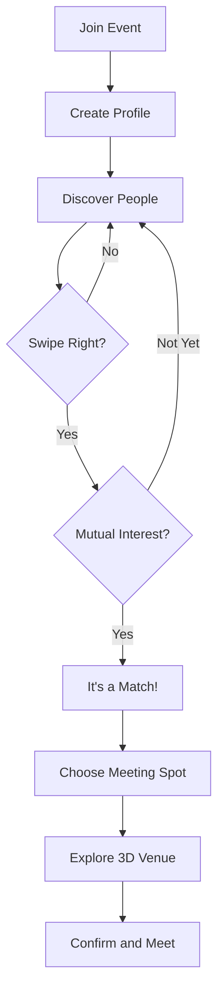
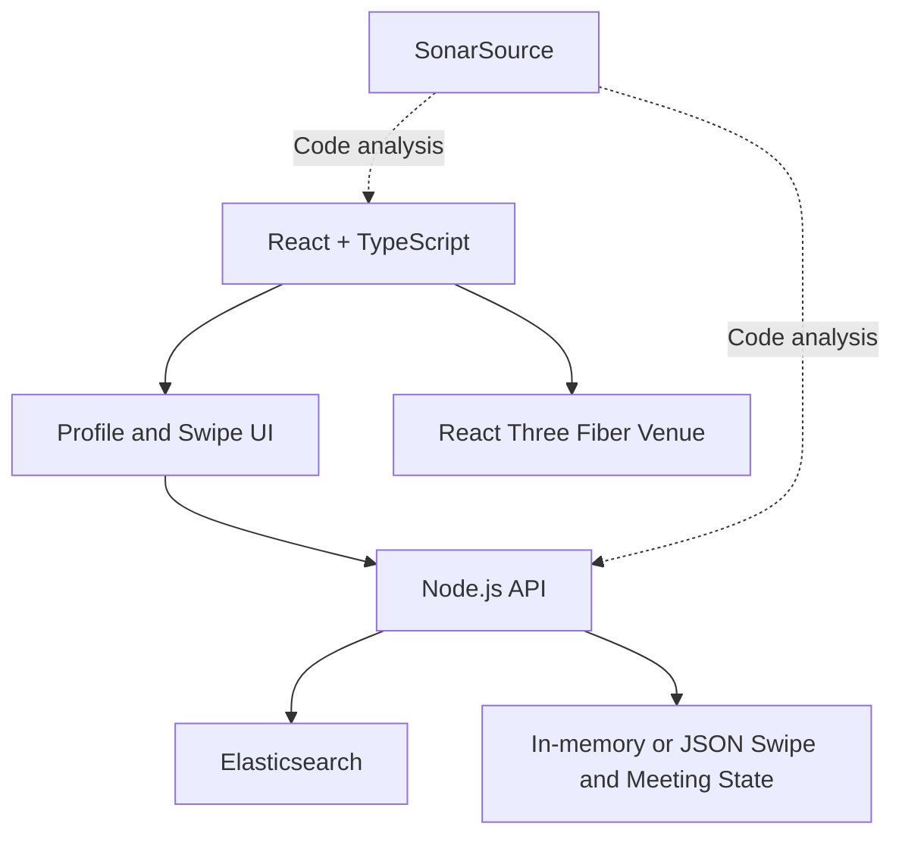

# MeetSpace — Hackathon MVP

> **Tagline:** Meet the right people, in the right place.

## Project overview

MeetSpace is a conference networking web app that helps attendees discover relevant people, express interest through Tinder-style swiping, and arrange in-person meetings using an interactive 3D map of the event venue.

- **Event venue:** The Shop Workspace, Salt Lake City, Utah
- **Build constraint:** One-day solo hackathon
- **Sponsor technologies:** Elasticsearch and SonarSource
- **Core journey:** Discover → Connect → Meet
- **Key demo moment:** A mutual match triggers a smooth 3D camera transition to a suggested meeting table.

## Problem

At conferences, attendees may be surrounded by hundreds of potential collaborators but struggle to find people who share their interests or have complementary goals. Even after finding someone relevant, arranging where to meet can be awkward.

## Solution

MeetSpace combines attendee recommendations, mutual-interest matching, and an interactive venue model. It prioritizes complementary goals (for example, a founder seeking an AI engineer) rather than relying only on identical interests.

## User flow

1. **Join event:** Open the predefined conference page and select **Join Event**.
2. **Create profile:** Enter name, role, interests, skills, goals, and short bio.
3. **Discover attendees:** View ranked profile cards with a short explanation of why each person is relevant.
4. **Swipe:** Pass or express interest. A mutual right swipe creates a match.
5. **Choose a meeting spot:** Select one of the venue's predefined meeting locations.
6. **Explore the 3D venue:** The camera flies to and highlights the selected location.
7. **Confirm meeting:** Show the person, place, and selected meeting time.



## MVP screens

### 1. Welcome

- MeetSpace name and tagline
- Event name and venue
- **Join Event** button
- No authentication required for the hackathon demo

### 2. Create profile

| Field | Example |
|---|---|
| Name | Alex |
| Role | AI Engineer |
| Interests | Machine Learning, Robotics |
| Skills | Python, PyTorch, React |
| Looking for | Startup cofounder |
| Bio | Building AI-powered products |

**Priority:** The “Looking for” field is essential for complementary-goal matching.

### 3. Discover people

Each attendee card displays:

- Name and role
- Interests and goals
- **Why connect?** explanation
- Illustrative compatibility score based on a simple, transparent ranking heuristic
- **Pass** and **Connect** actions

**Example:** Sarah is a healthcare startup founder seeking a technical cofounder. Alex has AI engineering experience, so the app recommends Sarah and explains the fit.

### 4. Matches

- Mutual matches list
- Match explanation
- **Find a Place to Meet** button
- Preload a reciprocal swipe in the demo to ensure the matching moment works without a second live user

### 5. Interactive 3D venue

- Simplified, recognizable model of The Shop Workspace
- Three demo meeting locations: **Lounge**, **Common Area**, **Meeting Table A**
- Clickable locations with labels
- Smooth camera movement and selected-location highlight
- Meeting confirmation card with person, location, and time

**Note:** Meeting spots and times are predefined demo options, not live availability or real-time indoor positioning. Use verified venue references when available; otherwise label the model as a conceptual representation.

## Data model

### Attendee

```json
{
  "id": "user_001",
  "name": "Alex",
  "role": "AI Engineer",
  "interests": ["AI", "Robotics"],
  "skills": ["Python", "PyTorch"],
  "lookingFor": ["Startup Cofounder"],
  "bio": "Building intelligent applications"
}
```

### Swipe

```json
{
  "fromUserId": "user_001",
  "toUserId": "user_002",
  "direction": "right"
}
```

### Meeting

```json
{
  "id": "meeting_001",
  "participants": ["user_001", "user_002"],
  "locationId": "table_a",
  "time": "14:30",
  "status": "confirmed"
}
```

## Technical architecture



### Technology choices

| Technology | Purpose |
|---|---|
| React + TypeScript | Frontend and attendee experience |
| React Three Fiber + Drei | 3D venue, controls, camera animation |
| Node.js | Profile recommendations, swipe logic, meeting endpoints |
| Elasticsearch | Index attendee profiles and rank relevant candidates |
| SonarSource | Analyze code quality and security |
| In-memory/JSON store | Minimal persistence for swipes and meetings |

### Matching approach

1. Index 10–15 seeded attendee profiles in Elasticsearch.
2. Retrieve candidates based on overlap in interests, skills, and goals.
3. Boost complementary matches, such as “looking for technical cofounder” versus “AI engineer.”
4. Compute an **illustrative** compatibility score using a simple heuristic, not a scientifically validated prediction.
5. Show a human-readable explanation of the match.
6. Exclude profiles already passed or swiped on.

For a one-day build, use straightforward text matching and ranking before considering embeddings or semantic search.

## One-day implementation plan

| Hours | Task | Deliverable |
|---|---|---|
| 1–2 | Project setup, seeded profiles, onboarding | Working profile flow |
| 3–4 | Elasticsearch integration and ranking | Recommended attendee cards |
| 5–6 | Swipe UI and mutual-match logic | Functional matchmaking |
| 7–8 | Simple 3D venue and camera animation | Interactive meeting spots |
| 9 | Connect matching to 3D meeting selection | End-to-end journey |
| 10 | SonarSource analysis, testing, demo practice | Demo-ready MVP |

### Scope guardrails

**Must have:** Profile, recommendations, swipes, seeded mutual match, simple 3D venue, meeting selection.

**Nice to have:** Animated fly-to-table transition, polished split-screen layout, SonarSource results in presentation.

**Out of scope:** Production authentication, live indoor tracking, real-time table availability, chat, fully accurate architectural model, elaborate ML training.

## Two-minute demo script

| Time | Demo action | Message |
|---|---|---|
| 0:00–0:20 | Introduce the problem | Conferences leave valuable connections to chance. |
| 0:20–0:45 | Create an AI engineer profile and discover Sarah | Elasticsearch surfaces relevant, complementary people. |
| 0:45–1:10 | Swipe right and show a mutual match | Discovery becomes a real connection. |
| 1:10–1:40 | Click Find a Place to Meet; fly camera to a table | The 3D venue bridges online matching and in-person interaction. |
| 1:40–2:00 | Confirm meeting and summarize | MeetSpace turns random encounters into meaningful connections. |

## Product design direction

Use a **split-screen layout** on the discovery screen: attendee cards on the left and a miniature 3D venue on the right. After a mutual match, activate the map, highlight a meeting spot, and smoothly move the camera there. This makes the 3D interaction central to the product rather than a disconnected extra feature.

## Success criteria

- A new attendee can complete a profile in under a minute.
- Recommendations visibly reflect the attendee's interests and goals.
- Swiping right on the seeded reciprocal match reliably triggers the match screen.
- A meeting location can be selected and highlighted in 3D.
- The entire journey can be demonstrated in two minutes.
- Elasticsearch is genuinely used for candidate retrieval/ranking; SonarSource is used for code analysis.

## Future extensions

- Event-specific networking zones and topic-based groups
- Opt-in attendee presence at venue areas
- Scheduling and messaging
- Contact exchange and post-event follow-ups
- More accurate venue models based on verified floor plans
- Semantic matching with embeddings
