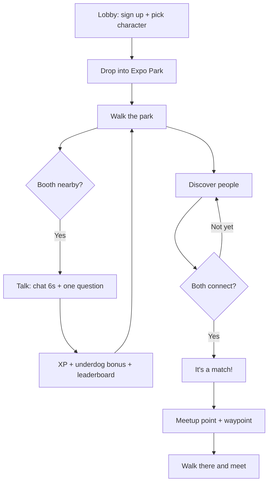
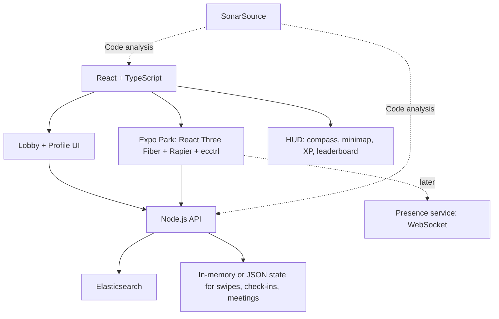

# MeetSpace — Hackathon MVP

> **Tagline:** Play the conference. Meet the right people and the right companies.

## Project overview

MeetSpace is a **virtual conference you play like a game**. Attendees sign up in a lobby, drop into **Expo Park** (our own 3D conference world), and walk a 3D character around to visit sponsor booths, collect XP, match with other attendees, and walk to a meetup point.

It combines two loops:
- **Booth Quest (careers).** Visit sponsor booths to earn XP. Booths with few visitors pay a bonus, so traffic spreads to companies that paid for a booth but get little attention, and attendees meet more companies.
- **People matching (networking).** Discover relevant people, swipe, and when two people both say yes, follow a waypoint to a meetup point.

- **Event:** a virtual conference in our own world, **Expo Park**. (The earlier plan to build the map from The Shop Workspace floor plans was dropped.)
- **Build constraint:** hackathon, team of four.
- **Sponsor technologies:** Elasticsearch and SonarSource.
- **Core journey:** Join → Explore → Connect → Meet.
- **Key demo moment:** you walk up to a glowing bounty booth, chat, answer one question, and the XP and leaderboard jump. Then a match appears and a beam leads your character to a meetup table.

## Problem

At conferences, attendees may be surrounded by hundreds of potential collaborators and dozens of companies, but struggle to find the right ones. Passport-style booth games send everyone to the same popular booths, so sponsors with quieter booths get little value from what they paid for. Even after finding a relevant person, arranging where and when to meet is awkward.

## Solution

MeetSpace turns the conference into a walkable game world.
- **Walk and explore.** A 3D character, third-person camera, and a compass, minimap and waypoints.
- **Underdog bonus.** Booths with fewer visits than average are worth more XP and shown with a gold beam, which points attention to the quiet sponsors.
- **Real engagement.** XP needs a walk-up check-in: be near the booth, chat for a few seconds, and answer one question about the company.
- **Career fit.** Booth cards show hiring roles and highlight the ones that match your profile.
- **Complementary matching.** People are ranked by complementary goals (a founder seeking an AI engineer), not only identical interests.

## User flow

1. **Lobby:** enter name, role, what you are looking for, skills, and pick an avatar color with a live 3D preview. Choose whether your name appears on the leaderboard.
2. **Drop in:** the camera lowers you into Spawn Plaza.
3. **Explore:** walk with WASD (or a joystick on phones), run, and jump. The minimap shows all booths, and bounties glow gold.
4. **Visit a booth:** walk up, press E (or tap Talk), read the pitch, chat for 6 seconds, answer one question, collect XP.
5. **Discover people:** view ranked profile cards with a short explanation of why each person is relevant. Pass or connect.
6. **Match:** a mutual connection creates a match.
7. **Meet:** a meetup point is suggested. A beam, ground arrows and the compass lead you there, and you get a message when you arrive.



## MVP screens

### 1. Lobby
- MeetSpace name, event name, a live "people in the lobby" count and a feed of who is joining
- Player card: display name, role, looking-for chips, skills, avatar color, 3D character preview, leaderboard opt-in
- Quest rules and controls
- **Enter conference** button. No authentication for the hackathon demo.

### 2. Expo Park (the game)
- Our own world with five zones: Spawn Plaza, Expo Street (10 booths), Careers Corner (6 booths), Networking Garden (meetup tables) and Keynote Stage
- Third-person 3D character you move, with collisions
- Simulated attendees walking around with name tags (placeholders for real multiplayer)
- HUD: compass, minimap, XP/level bar, leaderboard, controls hint

### 3. Booth dialog
- Company, tagline, hiring roles, and a "career fit" chip when roles overlap your profile
- Check-in reward (base XP plus underdog bonus)
- A 6-second chat timer, then a one-tap question; a wrong answer locks it for 5 seconds
- Checked-in booths turn grey and show "Visited"

### 4. Discover people
- Name and role, interests and goals
- **Why connect?** explanation
- Illustrative compatibility score from a simple, transparent heuristic
- **Pass** and **Connect** actions
- **Example:** Sarah is a healthcare startup founder seeking a technical cofounder. Alex is an AI engineer, so the app recommends Sarah and explains the fit.

### 5. Matches and meetup
- Mutual matches list with the match explanation
- Suggested meetup points (up to three) with a time
- Selecting one sets the waypoint: a beam, guide arrows, and the compass and objective banner
- A confirmation card with the person, place and time
- Preload a reciprocal swipe in the demo so the match works without a second live user

**Note:** meetup points and times are predefined demo options. Real-time presence of other attendees is not part of the MVP.

## Data model

### Attendee
```json
{
  "id": "user_001",
  "name": "Alex",
  "role": "AI Engineer",
  "interests": ["AI", "Robotics"],
  "skills": ["Python", "PyTorch"],
  "lookingFor": ["Startup Cofounder"],
  "offers": ["ML expertise"],
  "bio": "Building intelligent applications",
  "color": "#f472b6",
  "showOnLeaderboard": true
}
```

### Swipe
```json
{ "fromUserId": "user_001", "toUserId": "user_002", "direction": "right" }
```

### Booth and check-in
```json
{
  "id": "booth-lumen-labs",
  "slotId": "b01",
  "company": "Lumen Labs",
  "color": "#6366f1",
  "tagline": "Applied AI for healthcare",
  "hiring": ["ML Engineer", "Data Scientist"],
  "tags": ["python", "pytorch"]
}
```
```json
{ "boothId": "booth-lumen-labs", "attendeeId": "user_001", "base": 10, "bonus": 16 }
```

### Meeting
```json
{
  "id": "meeting_001",
  "participants": ["user_001", "user_002"],
  "spotId": "mp-garden-1",
  "time": "14:30",
  "status": "confirmed"
}
```

## Technical architecture



### Technology choices

| Technology | Purpose |
|---|---|
| React 19 + TypeScript + Vite | Game client and attendee UI |
| React Three Fiber + drei | 3D rendering, camera and helpers |
| Rapier (`@react-three/rapier`) + ecctrl | Physics and the third-person character controller |
| zustand | Game state (phase, position, waypoint, proximity) |
| Procedural character, optional CC0 KayKit glTF | 3D character with walk, run, jump and cheer animations |
| Node.js | Recommendations, swipe logic, check-in and meeting endpoints |
| Elasticsearch | Index attendee profiles and rank relevant candidates |
| SonarSource | Analyze code quality and security |
| In-memory / JSON store | Minimal persistence for the hackathon |

Deeper design (Postgres, presence, scaling to 800 or more players, observability) is in [`docs/system-design.md`](docs/system-design.md). The integration contract for the game client is in [`docs/venue-integration.md`](docs/venue-integration.md).

### Matching approach
1. Index 10–15 seeded attendee profiles in Elasticsearch.
2. Retrieve candidates based on overlap in interests, skills and goals.
3. Boost complementary matches, such as "looking for a technical cofounder" versus "AI engineer".
4. Compute an **illustrative** compatibility score from a simple heuristic, not a validated prediction.
5. Show a human-readable explanation of the match.
6. Exclude profiles already passed or swiped on.

For a one-day build, use straightforward text matching before considering embeddings or semantic search.

### Booth Quest rules
- A first visit is worth **10 XP**.
- **Underdog bonus:** up to **+25 XP** when a booth has fewer visits than the average booth, scaling down to 0 at or above the average. The bonus is locked in at check-in.
- A booth with a bonus of at least 15 XP is a **bounty**, shown with a gold beam and diamond.
- One credit per booth per attendee.
- Check-in needs: within 4.5 m of the booth front, 6 seconds of chatting, and one correct answer.
- The question is friction, not security. A real deployment verifies proximity and dwell time on the server.

## Build plan and status

| Area | Deliverable | Status |
|---|---|---|
| World | Expo Park with zones, 16 booth slots, 11 meetup points, validation | Done (12 unit tests) |
| Game | Third-person 3D character, collisions, camera, keyboard and touch controls | Done |
| Lobby | Sign-up, character preview, quest rules, join feed | Done (data kept locally) |
| Booth Quest | Walk-up check-in, underdog bonus, leaderboard, bounties, career fit | Done on mock data |
| Meetup | Waypoint beam, ground arrows, compass, arrival message | Done (suggestions are mocked) |
| Discover and swipe | Profile cards, "why connect", swipe, mutual match | **To do** |
| Elasticsearch | Index and rank seeded profiles with explanations | **To do** |
| Backend | Join, check-in, leaderboard and meeting endpoints | **To do** |
| Code quality | SonarSource analysis and results for the presentation | **To do** |

### Scope guardrails

**Must have:** lobby, walkable world with a 3D character, booth check-in with XP and the underdog bonus, leaderboard, discover and swipe, seeded mutual match, meetup waypoint.

**Nice to have:** a rigged glTF character, real backend endpoints in place of mocks, SonarSource results in the presentation, polished HUD animation.

**Out of scope:** production authentication, real multiplayer, voice or video chat, chat, a fully accurate world model, elaborate ML training.

## Two-minute demo script

| Time | Demo action | Message |
|---|---|---|
| 0:00–0:15 | Introduce the problem | Passport games send everyone to the same booths, and the right people are hard to find. |
| 0:15–0:35 | Sign up in the lobby, pick a character, enter, and drop into the park | Conferences become a world you walk around. |
| 0:35–1:00 | Follow a gold beam to a quiet booth, press E, chat and answer | Quiet sponsors pay more XP, so traffic spreads. |
| 1:00–1:20 | The leaderboard and XP jump; show career fit | Attendees meet more companies and see relevant roles. |
| 1:20–1:45 | Discover and swipe right on the seeded reciprocal match | Elasticsearch surfaces relevant, complementary people. |
| 1:45–2:00 | A match appears; the beam leads you to a meetup table, and you arrive | MeetSpace turns random encounters into meaningful connections. |

## Product design direction

A bright, toy-like park with a tactical HUD: compass, minimap, waypoints, bounties and quest toasts. It is **inspired by the feel of AR-walking and battle-royale-style games, with an original look and names and no assets from any game**. Booths are glowing "stops" with spinning company tokens, and bounties are gold beams that can be seen across the park. Keep the HUD readable on a phone, with a joystick and large Jump and Talk buttons.

## Success criteria

- A new attendee can complete the lobby in under a minute and be walking within seconds.
- The character moves smoothly with collisions on desktop and on a phone.
- A booth check-in reliably awards XP, including the underdog bonus, and updates the leaderboard.
- Quiet booths are visibly more attractive (gold beam, higher XP).
- Recommendations visibly reflect the attendee's interests and goals.
- Swiping right on the seeded reciprocal match reliably produces a match, and a meetup waypoint appears.
- The entire journey can be demonstrated in two minutes.
- Elasticsearch is genuinely used for candidate retrieval and ranking. SonarSource is used for code analysis.

## Future extensions

- Real multiplayer presence (opt-in), with players seen around you
- Proximity text chat or voice when matched people meet
- Server-verified check-ins from presence, and anti-cheat checks
- Timed events and bounties set by organizers, a keynote with live attendance
- Organizer dashboard: visit funnel per booth, and how the underdog bonus shifts traffic
- Several character choices and customisation
- Scheduling, contact exchange and post-event follow-ups
- Semantic matching with embeddings
- A hybrid mode: the same world alongside a physical event, with booth staff scanning badges
