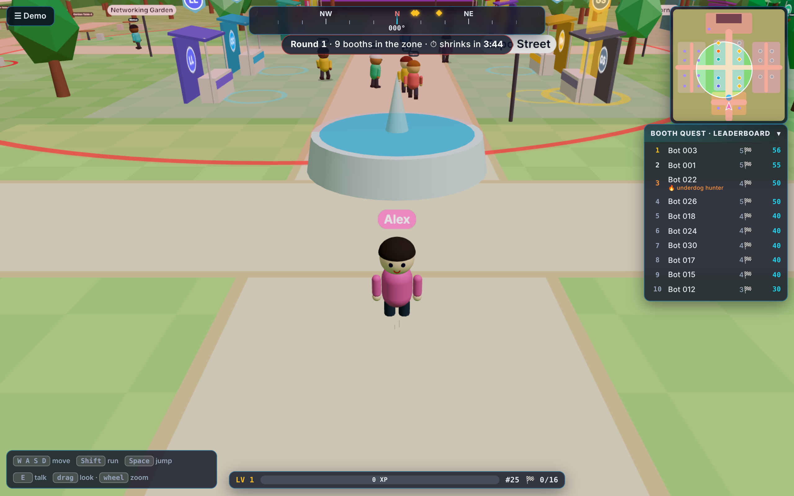
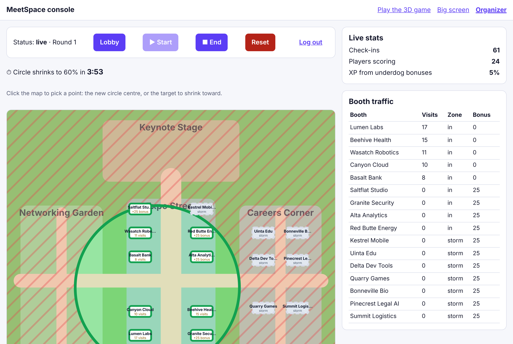

# Salty-Cluster – Battle Royale for Conference Expo Floors

## The problem
At big tech conferences, the biggest sponsors win attention with huge booths, branded staff and great swag. Smaller sponsors and open-source projects get lost on the floor, and attendees miss them.

What we heard today:
- Attendee: "If they have nice swag, then I'm stopping by... you never know who has the coolest swag until you see someone else with the swag."
- Attendee: "You're not going to find people randomly. You find some, but you miss others."
- Sponsor: "You want to be as large as your competitors, even if you're like the underdog."
- Sponsors don't measure foot traffic. They measure demos, then proofs of concept, then customers.

Passport games try to fix this, but they send everyone to the same booths and count scans, not demos.

## Our solution
**MeetSpace**: the expo floor as a battle royale you can play in 3D or walk in real life.
- The organizer controls a **shrinking circle** that guides people to where the conference needs them. Booths outside it are "in the storm" and pay nothing.
- Attendees check in at booths by walking up in the 3D world (or scanning the QR code at a physical booth) and answering one question about the demo.
- **Least-visited booths pay an underdog bonus**, so traffic spreads across the floor.
- Live leaderboard, with prizes for the top 3 attendees.

| 3D game (Expo Park) | Organizer console |
|---|---|
|  |  |

Big screen next to the stage: [docs/screenshots/screen.png](docs/screenshots/screen.png)

### Scoring (`packages/venue`, shared by game, console and server)
| | XP |
|---|---|
| First visit to a booth inside the circle | 10 |
| Underdog bonus (booth has fewer visits than average) | up to +25 |
| Booth in the storm | 0, and the booth isn't used up |

## Architecture
- **Frontend:**
  - `apps/web`: the 3D game (React Three Fiber, Rapier physics, ecctrl character controller). Lobby, Expo Park, walk-up check-in, HUD with storm wall, minimap circle and shrink countdown.
  - `apps/console`: organizer console (move/shrink/schedule the circle, stats, printable booth QR codes), big screen, and QR check-in for physical booths.
- **Backend:** `apps/api`, Node 22 + Fastify 5 + TypeScript.
- **Elasticsearch:** booths as geo-points, the circle as a `geo_distance` query, the leaderboard and underdog bonus from aggregations. It is the only datastore. See [docs/elasticsearch.md](docs/elasticsearch.md).
- **Kubernetes on Radar, deployed with Argo CD:** [docs/kubernetes.md](docs/kubernetes.md)
- **OpenTelemetry + Dash0** for traces, logs and metrics (plus RUM in the browser): [docs/observability.md](docs/observability.md)
- **Gitar reviews every pull request:** [docs/gitar.md](docs/gitar.md)

```
 browser ──► web (nginx): 3D game at /, console at /console/ ──/api──► api (Fastify) ──► Elasticsearch
    │ RUM                                                                │ OTLP
    └─────────────► Dash0 ◄──────────── OTel Collector ◄─────────────────┘  (+ k8s events, pod metadata)
 GitHub (Gitar review, CI) ──► ghcr.io images ──► Argo CD ──► Kubernetes namespace (Radar)
```

Game design and world: [docs/venue-integration.md](docs/venue-integration.md), [docs/system-design.md](docs/system-design.md).

## How to run it
Requires Node 22 and pnpm 11 (`corepack enable`).

### Quickest: no Docker, in-memory API (dev only)
```bash
pnpm install
pnpm dev:memory          # API on :8080 with an in-memory store (data resets on restart)
pnpm dev                 # 3D game on http://localhost:5173
pnpm dev:console         # console on http://localhost:5174/console/
```
In the console, open **Organizer** (token `dev-organizer`) and press **▶ Start**. Then play at http://localhost:5173 (`?demo=booth` jumps straight to a booth).

### With Elasticsearch
```bash
cp .env.example .env
docker compose up -d     # Elasticsearch :9200, OTel Collector :4318
pnpm es:setup && pnpm seed
pnpm dev:api             # API on :8080, backed by Elasticsearch
pnpm dev                 # game
```

### Simulated attendees (demo traffic and load test)
```bash
API_URL=http://localhost:8080 pnpm simulate -- --players 60 --seconds 90 --follow 0.8
```
Bots chase the underdog bonus with probability `--follow`. Compare the printed **spread** with `--follow 0`: that is the bonus spreading traffic, measured.

### Tests
```bash
pnpm typecheck && pnpm test   # venue rules + API (14 tests against an in-memory Elasticsearch stand-in)
pnpm e2e                      # Playwright: 3D game and console against the real API code, with axe checks
pnpm smoke                    # full game against a real Elasticsearch (resets indices!)
```

### Kubernetes
See [docs/kubernetes.md](docs/kubernetes.md). In short: create the `salty-secrets` secret, then `kubectl apply -n argocd -f deploy/argocd/application.yaml`.

## Tracks
Elastic · Radar · Dash0 · Sonar (Gitar)

## Use of AI tools
- Claude Code: 3D game workstream, backend, console, tests, Kubernetes/CI and docs, landed through reviewed pull requests
- Gitar: AI code review and CI failure fixes on every PR
- [Add any other assistants the team used]

## Team
Salt Cluster: [names]
